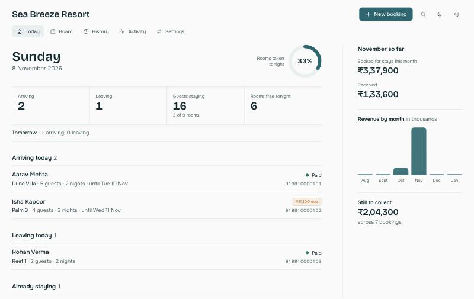
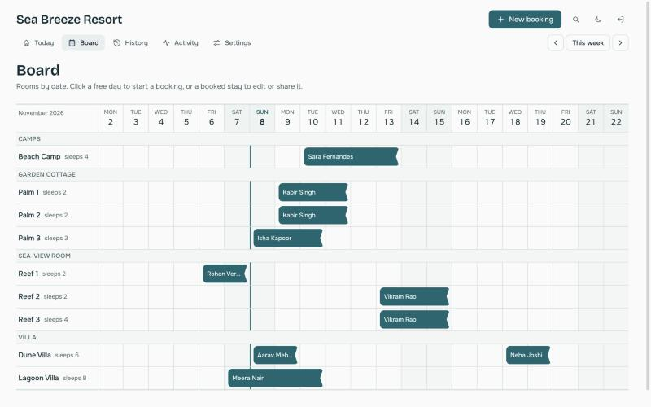
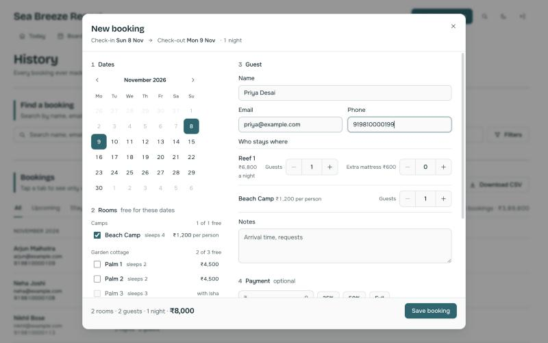
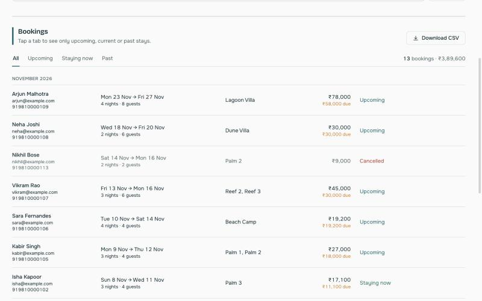
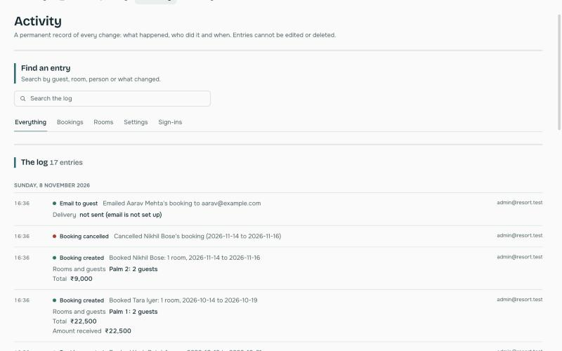
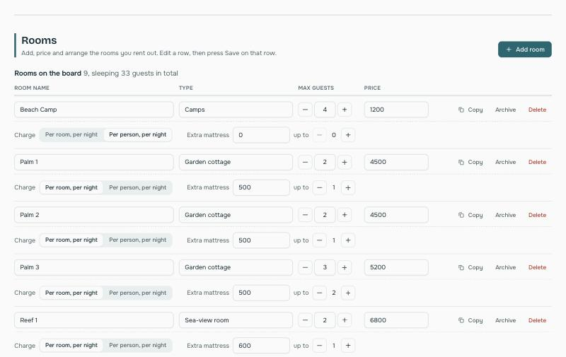
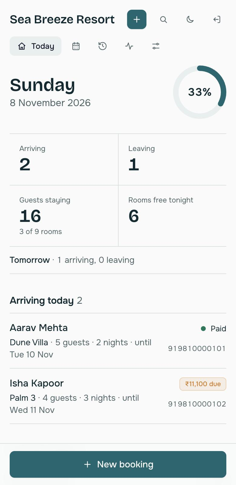

# Resort Booking System

A booking system for a small resort. Staff pick dates, choose rooms, enter the guest's details and send them a confirmation with a calendar file. It tracks who is arriving, what has been paid, and keeps a permanent record of every change.

It runs on Cloudflare Workers and D1, so there is no server to look after and the free plan is enough for a single resort.



## Contents

- [What it does](#what-it-does)
- [Screenshots](#screenshots)
- [Tech stack](#tech-stack)
- [Run it on your computer](#run-it-on-your-computer)
- [Put it online](#put-it-online)
- [Settings and secrets](#settings-and-secrets)
- [Email](#email)
- [Using it](#using-it)
- [How pricing works](#how-pricing-works)
- [Keyboard shortcuts](#keyboard-shortcuts)
- [Project layout](#project-layout)
- [API](#api)
- [Security](#security)
- [Not included yet](#not-included-yet)
- [Credits](#credits)

## What it does

**Bookings**
- A room board with rooms down the side and days across. Click a free day to start a booking, or a stay to edit it.
- A booking can hold several rooms. Each room has its own guests and extra mattresses. Putting more guests in a room than it sleeps only shows a warning.
- Double-booking is blocked. A stay can start on the day another one ends.
- Returning guests are suggested as you type a name, and fill in their email and phone.
- Cancelled bookings stay in History.

**Sharing with the guest**
- Email a confirmation with a calendar file (`.ics`) attached, using Resend or any SMTP server.
- Each booking has a private page for the guest with an itemised invoice, an "Add to my calendar" button and print or save as PDF.
- One click to copy the link or send it on WhatsApp.
- A reminder email goes out the evening before check-in.

**Money**
- Rooms are charged per room or per person, per night. Each room can have a different price on chosen days of the week (for example Monday and Tuesday one price, Wednesday and Thursday another). Extra mattresses have their own price.
- Record the amount received and the method (cash, UPI, card, bank). Totals and balances update live.
- A booking keeps the prices it was quoted, so changing a room's price later never changes old bookings.

**Running the day**
- **Today** shows arrivals, departures, who is staying, free rooms, occupancy, this month's revenue and the balance still to collect.
- **History** lists every booking with search, filters (dates, payment, status) and a CSV download.
- **Activity** is an audit log of every change. It records who did it, when, and the before and after values. The database refuses edits and deletes to it.
- A private calendar link puts every confirmed booking into Google Calendar or Apple Calendar.

**Built for real use**
- Works on phones, tablets and desktops, with a light and a dark theme.
- Ctrl or Cmd + K opens a search that finds a guest or jumps to a page.
- Keyboard shortcuts for the common actions.

## Screenshots

| Board | New booking |
| --- | --- |
|  |  |

| History | Activity (audit log) |
| --- | --- |
|  |  |

| Settings: rooms and pricing | On a phone |
| --- | --- |
|  |  |

The screenshots use made-up guests and a demo resort.

## Tech stack

| Part | Choice |
| --- | --- |
| Hosting and API | Cloudflare Workers (one file, `worker/index.ts`) |
| Database | Cloudflare D1 (SQLite) |
| Frontend | React 19, TypeScript, Vite, Tailwind CSS 4 |
| Components | [befui](https://befui.vercel.app) (Radix UI and Tailwind), copied into `src/components/ui` |
| Email | Resend over HTTP, or SMTP through `worker-mailer` |
| Scheduling | Cloudflare Cron Triggers (daily reminders) |
| Auth | Signed session cookie, checked with the Web Crypto API |

There is no server framework, ORM, or state library.

## Run it on your computer

You need Node.js 20.19 or newer (or 22.12 or newer).

```bash
npm install
```

Create your local settings file and edit it if you like:

```bash
cp .dev.vars.example .dev.vars
```

Create the local database with the tables and a few demo rooms:

```bash
npm run db:local
```

Start the app:

```bash
npm run dev
```

Open http://localhost:5173 and sign in with the `ADMIN_EMAIL` and `ADMIN_PASSWORD` from `.dev.vars`. The example file uses `admin@resort.test` and `change-me-now`.

With no email settings, emails are printed in the terminal instead of being sent, so you can try everything without setting up a mail provider.

Other scripts:

| Command | What it does |
| --- | --- |
| `npm run build` | Type-check and build for production |
| `npm run preview` | Preview the production build |
| `npm run deploy` | Build and deploy to Cloudflare |
| `npm run db:local` | Create the local database tables and demo rooms |
| `npm run db:remote` | Create the tables and demo rooms in the online database |

## Put it online

You need a free [Cloudflare](https://cloudflare.com) account. Run these in the project folder.

**1. Log in.** This opens your browser.

```bash
npx wrangler login
```

**2. Create the database.**

```bash
npx wrangler d1 create resort
```

It prints a `database_id`. Paste it into `wrangler.jsonc`, replacing the existing one.

> When Wrangler asks "Would you like Wrangler to add it on your behalf?", answer **n**. The app expects the binding to be named `DB`, and Wrangler would name it `resort`.

**3. Create the tables and the demo rooms.**

```bash
npm run db:remote
```

**4. Edit `wrangler.jsonc`.** Set `RESORT_NAME` and `MAIL_FROM`. You can also change the resort name later in Settings.

**5. Deploy.**

```bash
npm run deploy
```

**6. Set your login and email secrets.** Each command asks you to type the value.

```bash
npx wrangler secret put ADMIN_EMAIL
```

```bash
npx wrangler secret put ADMIN_PASSWORD
```

```bash
npx wrangler secret put SESSION_SECRET
```

Make `ADMIN_PASSWORD` long and unique. For `SESSION_SECRET`, any long random text works, for example the output of `openssl rand -hex 32`.

Then set up email (see [Email](#email)).

**7. Open your site.** It is at `https://resort-booking.<your-account>.workers.dev`. Put that address in `APP_URL` in `wrangler.jsonc` and run `npm run deploy` once more, so reminder emails can link to the booking page. To use your own domain, open your worker in the Cloudflare dashboard, then Settings, then Domains.

**8. Add your rooms.** Sign in, open Settings and replace the demo rooms with your own.

To change the password later, run `npx wrangler secret put ADMIN_PASSWORD` again.

## Settings and secrets

**Secrets** (set with `wrangler secret put`, or in `.dev.vars` locally):

| Name | Required | What it is |
| --- | --- | --- |
| `ADMIN_EMAIL` | yes | The sign-in email |
| `ADMIN_PASSWORD` | yes | The sign-in password |
| `SESSION_SECRET` | yes | Random text used to sign the session cookie |
| `RESEND_API_KEY` | one email option | Use Resend |
| `SMTP_HOST`, `SMTP_PORT`, `SMTP_USER`, `SMTP_PASS` | one email option | Use an SMTP server instead |

**Variables** (in `wrangler.jsonc`):

| Name | Default | What it is |
| --- | --- | --- |
| `RESORT_NAME` | `Your Resort` | Shown in emails and on pages. Can be changed in Settings. |
| `CURRENCY` | `INR` | Currency code for all amounts |
| `MAIL_FROM` | | Sender, such as `Sea Breeze <bookings@yourdomain.com>` |
| `APP_URL` | empty | Your site address, used for links in reminder emails |

The reminder job runs daily at 12:30 UTC. Change `triggers.crons` in `wrangler.jsonc` to move it.

## Email

Set up one of these. If neither is set, emails are logged instead of sent.

**Resend (simplest).** Create an account at resend.com, verify your sending domain, create an API key, and set `RESEND_API_KEY`. `MAIL_FROM` must use the verified domain.

**SMTP.** Set `SMTP_HOST`, `SMTP_PORT`, `SMTP_USER` and `SMTP_PASS`. Port 465 (secure) and 587 (STARTTLS) work on Cloudflare. Port 25 does not.

IMAP is not used. It is for reading a mailbox, and this app only sends.

## Using it

**Make a booking.** Press `N` or use New booking. Pick the check-in and check-out days on the calendar, tick the rooms, say how many guests are in each, add the guest's details and any payment, then save. A confirmation screen lets you email the guest, copy the link or send it on WhatsApp.

**Change or cancel.** Click a stay on the Board, or a row in History. The window also shows that booking's activity.

**Take payment.** In the booking window, enter the amount received (or use 25%, 50% or Full) and pick the method. History and Today show what is still due.

**Staff calendar.** In Settings, copy the staff calendar link. In Google Calendar choose Other calendars, then From URL. Anyone with the link can see guest names, so share it with staff only. "Make a new link" cancels the old one.

**Reminders.** Guests get an email the evening before check-in. Settings has a button to send tomorrow's reminders now.

**Rooms.** In Settings you can add, edit, copy, archive and delete rooms. Archiving hides a room but keeps its history. A room that has ever been booked cannot be deleted, only archived.

## How pricing works

Each room has a normal price and a way of charging:

- **Per room, per night:** the price is the same however many people stay.
- **Per person, per night:** the price is multiplied by the number of guests in that room.

**Prices by day of the week.** In Settings, under a room, "Different price on some days" lets you pick days and type a price for them. Add as many groups as you need. Days you do not pick use the room's normal price. For example, with a normal price of 4,500:

| Days | Price |
| --- | --- |
| Mon, Tue | 4,000 |
| Wed, Thu | 3,000 |
| Fri, Sat, Sun (not picked) | 4,500 |

A night counts by the day it starts, so Friday night is the night from Friday to Saturday. A stay from Monday to the next Monday is seven nights: 4,000 + 4,000 + 3,000 + 3,000 + 4,500 + 4,500 + 4,500 = 27,500. A day can be in only one group; picking it in a second group moves it.

**Extra mattresses.** A room can allow extra mattresses (a price per night and a maximum). Each mattress adds one guest to the room's usual limit.

**Capacity is a warning, not a lock.** If you put more guests in a room than it sleeps, the booking window shows an amber warning and still lets you save.

Each night costs that day's price (times the guests in the room for per-person rooms) plus the mattress price. The booking total is the sum of all its nights over all its rooms.

**Old bookings never change price.** When a booking is made, the room's seven daily prices, the charging method and the mattress price are saved on it, together with the total. Editing a room later affects only new bookings. If you move a booking's dates, its nights are priced again using the prices it was quoted.

## Keyboard shortcuts

They pause while you type in a box or have a window open. Press `?` in the app to see this list in Settings.

| Keys | Action |
| --- | --- |
| `N` | New booking |
| `Ctrl` or `Cmd` + `K` | Search guests, jump to a page |
| `G` then `T` / `B` / `H` / `A` / `S` | Go to Today / Board / History / Activity / Settings |
| `Left` and `Right` arrows | Previous and next week (Board) |
| `T` | Jump to this week (Board) |
| `/` | Search bookings (History) |
| `?` | Show the shortcuts |
| `Esc` | Close a window |

## Project layout

```
worker/index.ts      The whole backend: API, auth, email, reminders, audit log
src/                 The React app
  App.tsx            Routes and sign-in guard
  Board.tsx          Page frame, navigation and the room board
  Today.tsx          The Today page
  History.tsx        Booking history
  Activity.tsx       The audit log page
  Settings.tsx       Rooms, resort name, calendar link, shortcuts
  BookingDialog.tsx  The booking window
  Guest.tsx          The private guest booking page and invoice
  components/ui/     befui components
schema.sql           Tables for a new database
seed.sql             Demo rooms
migrate-*.sql        Upgrades for databases made by an earlier version
wrangler.jsonc       Cloudflare configuration
docs/screenshots/    Images used in this README
```

**Upgrading.** A new install only needs `schema.sql`. If you set up the database with an earlier version, run the `migrate-*.sql` files that came after it, once, **before** you deploy the new code:

- `migrate-v5.sql` adds prices by day of the week. Existing bookings keep their totals.

```bash
npx wrangler d1 execute resort --remote --file=migrate-v5.sql
```

## API

All routes are under `/api`. Everything except the public routes needs the signed-in session cookie.

| Route | Purpose |
| --- | --- |
| `POST /login`, `POST /logout`, `GET /me` | Session |
| `GET /today?date=` | Arrivals, departures, occupancy, revenue |
| `GET /rooms`, `POST /rooms`, `PUT` / `DELETE /rooms/:id` | Rooms |
| `GET /bookings?from=&to=` | Bookings in a date range |
| `POST /bookings`, `PUT` / `DELETE /bookings/:id` | Create, edit, cancel |
| `POST /bookings/:id/email` | Email the booking to the guest |
| `GET /history` | Search and filter every booking |
| `GET /audit` | The audit log |
| `GET` / `PUT /settings`, `POST /settings/calendar-token` | Resort name and calendar link |
| `POST /reminders/run` | Send tomorrow's reminders now |
| `GET /public/:token` and `/public/:token.ics` | Public: the guest's page and calendar file |
| `GET /calendar/:token.ics` | Public: the staff calendar feed |

Dates are `YYYY-MM-DD`. A booking's check-out day is the day the guest leaves, so a stay from the 10th to the 12th is two nights.

## Security

- Sign-in checks the password in constant time and sets an `HttpOnly`, `SameSite=Lax` cookie that is marked `Secure` on HTTPS.
- Guest links are 32 random characters and show the guest's name, dates, rooms and amounts. They never show the phone, email or notes.
- The audit log table refuses `UPDATE` and `DELETE`, so history cannot be rewritten through the app. Failed sign-ins are recorded with the address they came from.
- The login is a single shared account. There is no lockout after repeated wrong passwords yet.
- Secrets are never in the repository: `.dev.vars` is git-ignored and online secrets live in Cloudflare.

## Not included yet

- Separate logins for each staff member, and a lockout after repeated wrong passwords.
- Blocking a room for maintenance, and dragging stays on the board.
- Online payment (Razorpay or Stripe). Payments are recorded by hand.
- Seasonal prices, taxes and discounts.
- An automated test suite. The project is type-checked and was checked by hand.

## Credits

Interface components from [befui](https://befui.vercel.app). Built on [Cloudflare Workers](https://workers.cloudflare.com), [D1](https://developers.cloudflare.com/d1/), [React](https://react.dev) and [Tailwind CSS](https://tailwindcss.com). Email through [Resend](https://resend.com).
